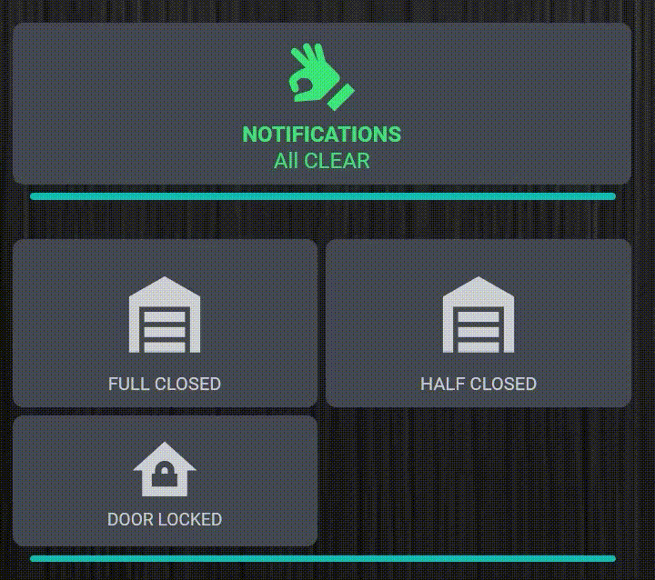
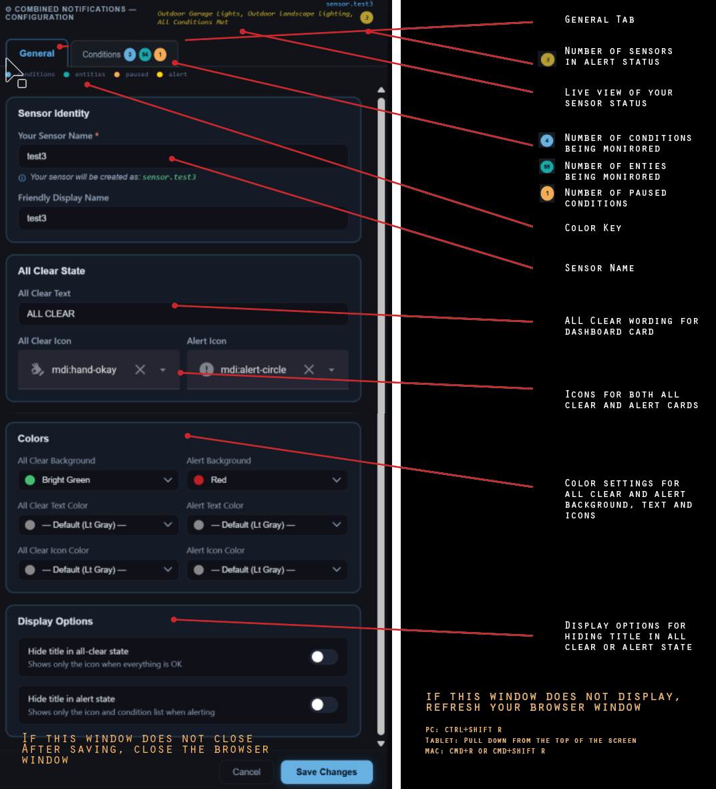
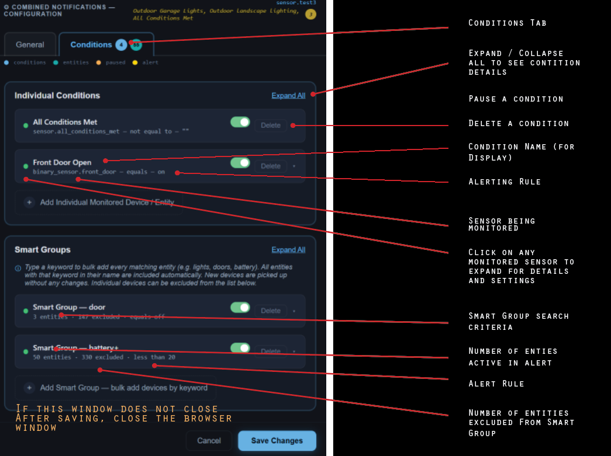
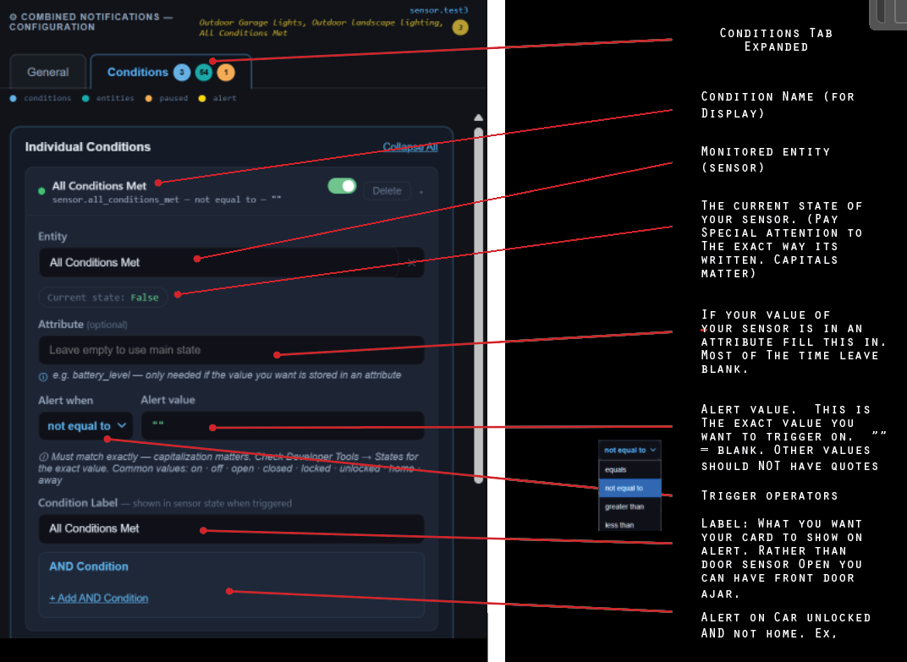
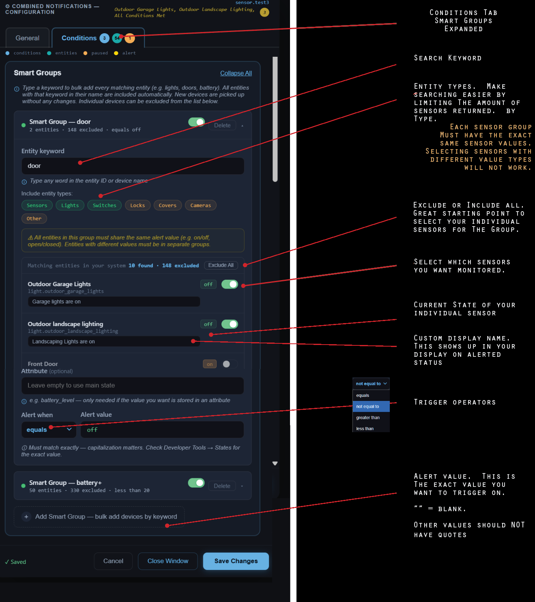

# Advanced Group Sensor for Home Assistant — v1.1.x


[](media/demo.gif)

**Monitor and group multiple entity conditions — all on ONE SENSOR & ONE CARD. No YAML editing required.**

Hundreds of conditions can be monitored with no slowdown or lagging in your frontend dashboard.

Advanced Group Sensor (AGS) monitors the entities you choose and alerts you when something needs attention — with a count of exactly how many are at fault.

- 3 lights left on: **Bathroom Light, Kitchen Light, Garage Light** — count: 3
- Door left unlocked: **Kitchen Doorwall Unlocked** — count: 1
- Battery critical: **Back Door Sensor 12%** — count: 1
- Something you have to do yourself: **Bailey Medication Due** — count: 1

No entity IDs. Just the **custom names you** gave your devices. All on **one sensor, and one card**.

AGS is the successor to Combined Notifications. If you are coming from Combined Notifications, see **[Moving from Combined Notifications](#️-moving-from-combined-notifications)**.

---

## 📋 Table of Contents

- [Features](#-features)
- [What's New in 1.1.x](#-whats-new-in-11x)
- [Installation](#-installation)
- [Setup](#️-setup)
- [Configuration Panel](#️-configuration-panel)
  - [General Tab](#general-tab)
  - [Individual Conditions](#individual-conditions)
  - [Dynamic Labels — Live Values in Your Alerts](#-dynamic-labels--live-values-in-your-alerts)
  - [Smart Groups](#smart-groups)
  - [Task Trackers](#-task-trackers)
  - [Overview Tab](#overview-tab)
  - [Backup & Restore and Duplicate Sensor](#-backup--restore-and-duplicate-sensor)
- [Attributes Sensor Option](#-attributes-sensor-option)
- [Moving from Combined Notifications](#️-moving-from-combined-notifications)
- [Sensor Behavior](#-sensor-behavior)
- [Alert Count](#-alert-count)
- [Automations — One Sensor, One Trigger, Unlimited Actions](#-automations--one-sensor-one-trigger-unlimited-actions)
- [Dashboard Cards](#️-dashboard-cards)
- [Alert Ticker Card Pairing](#-alert-ticker-card-pairing)
- [Advanced Group Sensor vs Alert Ticker](#-advanced-group-sensor-vs-alert-ticker)
- [Troubleshooting](#-troubleshooting)
- [A Note from the Developer](#-a-note-from-the-developer)
- [Removal](#️-removal)
- [License](#-license)
- [Addendum — Attribute Mode Card & Automation Examples](#️-attribute-mode-users-only--dashboard-cards--automations)

---

## ✅ Features

- Monitor unlimited entities with flexible alert conditions
- **Individual conditions** — monitor specific entities one at a time
- **Smart Groups** — bulk-add entities by keyword (e.g. all `door`, all `battery`, all `light`)
- **"AND" conditions** — is the car unlocked AND not in the garage? Is the back door open AND nobody is home? Get an alert only when both are true
- **Pause** conditions without deleting them. A sensor goes bad? Pause it and everything else keeps working
- **Live Sensor State** shown right in the panel — no more hunting Developer Tools to figure out if your sensor says `open`, `Open`, `true`, or `1`
- **Dynamic Labels** — alert text that pulls in live sensor data using Jinja2 templates. Instead of a static "Lightning Detected," show **"Lightning 5 Miles North"**
- **Alert Count** sensor created automatically alongside every sensor you make
- **Task Trackers** — reminders for things Home Assistant can't see you do, with a Done button for each
- **Attribute mode** for large setups that hit Home Assistant's 255-character limit
- Fully configured from the UI — no YAML required
- Still ONE sensor, ONE card

---

## 🆕 What's New in 1.1.x

- **Task Trackers** — meds, workouts, paying rent, birthdays. See **[Task Trackers](#-task-trackers)**.
- **Import from Combined Notifications** — move every Combined Notifications sensor over in one go, keeping entity IDs. See **[Moving from Combined Notifications](#️-moving-from-combined-notifications)**.
- **Duplicate Sensor** — copy a sensor, including its Task Trackers, under a new name.
- **Home Assistant 2026.11 ready** — device and entity names follow the new HA naming. Dashboard cards with no name set show your Friendly Display Name.

---

## 📦 Installation

1. Open **HACS** in Home Assistant
2. Go to **Integrations**
3. Search for **Advanced Group Sensor**
4. Click **Download**
5. Restart Home Assistant
6. Go to **Settings → Devices & Services → Add Integration** and search for **Advanced Group Sensor**

Requires Home Assistant 2024.12.0 or newer.

---

## ⚙️ Setup

1. Go to **Settings → Devices & Services → Add Integration → Advanced Group Sensor**
2. Enter your **Sensor Name** and an optional **Friendly Display Name**
3. Open **Settings → Devices & Services → Advanced Group Sensor → Configure**, then click **Open configuration panel**
4. Add conditions, Smart Groups and tasks, and set your colors and icons
5. Click **Save Changes**

To modify settings later — add/delete entities, change triggers, update colors/icons — go back to **Settings → Devices & Services → Advanced Group Sensor → Configure**. No YAML or restart required.

> Sensor names must use lowercase letters and underscores only — no spaces, no capitals.
> Example: `sensor.YOUR_SENSOR_NAME`

### Make Your Dashboard Card

a. Go to your dashboard and add a manual card

b. Copy the YAML of the card type you like from **[Dashboard Cards](#️-dashboard-cards)** below

c. Paste it into the manual card box

d. Change the sensor name. That's it — Enjoy!

---

## 🖥️ Configuration Panel

The panel has five tabs: **General**, **Individual**, **Smart Groups**, **Tasks** and **Overview**. Badges on each tab show how many items are active, paused or alerting.

> The screenshots below were taken in Combined Notifications. The AGS panel is laid out the same way; only the header and the extra tabs differ.

### General Tab



See the image above for all settings. If the panel does not display after selecting Configure, refresh your browser:
**PC:** `Ctrl+Shift+R` · **Tablet:** Pull down from top · **Mac:** `Cmd+R` or `Cmd+Shift+R`

If the window does not close after saving, close the browser window.

---

### Individual Conditions

The Individual tab shows all monitored conditions at a glance.



Click any condition to expand it and configure the entity, alert rule, label, and optional AND condition.



Look at the configuration panel — it shows the current state of your entity right there. That should give you a strong indication of exactly what value to use.

Alert Value: `""` = blank. Other values do NOT use quotes.

---

### ⚡ Dynamic Labels — Live Values in Your Alerts

Normally a condition's label is fixed text — "Lightning Detected," "Front Door Open." **Dynamic Labels** let that label pull in live data from your sensors at the moment the alert fires, using Jinja2 templates.

Expand any individual condition and toggle on **Use Jinja2 template for label**. Two fields appear:

- **Jinja2 Template** — the template that renders your live alert text. Multiple lines are supported.
- **Fallback Label** — plain text shown if the template hits an error or a sensor is unavailable.

When the toggle is on, the plain label field is disabled — the template takes over.

#### Example — Lightning distance and direction

Using the Blitzortung integration, this condition alerts when lightning strikes within 10 miles and shows exactly how far and which direction:

**Condition:** `sensor.home_lightning_distance` · less than · `10`

**Template:**

```jinja2


Lightning {{ mi }} Mile{{ 's' if mi != 1 else '' }} {{ dirs[(((states('sensor.home_lightning_azimuth') | float) + 22.5) // 45) | int % 8] }}
```

The template field accepts multiple lines, so you can format it like this for readability — or paste it all on one line. Both render identically.

**Fallback:** `Lightning Detected`

This renders **"Lightning 5 Miles North"**, handles the singular "1 Mile," rounds up so it never shows "0 Miles," and converts the azimuth degrees into a compass direction. When the storm passes and the distance sensor returns to `unknown`, the alert clears on its own.

#### Other ideas

- Battery: `Phone battery low: {{ states('sensor.phone_battery') }}%`
- Packages: `{{ states('input_number.package_count_front') | int }} packages at the front door`
- Any numeric sensor can contribute its real value to the alert text.

> ⚠️ **Heads up on the 255-character limit:** Dynamic Labels produce longer alert text than static labels. If you use several at once, the combined sensor state can hit Home Assistant's 255-character limit. Pair Dynamic Labels with **[Attribute Mode](#-attributes-sensor-option)** to move the full alert list into an attribute with no length limit.

---

### Smart Groups

Smart Groups bulk-add every entity matching a keyword. Open the configuration panel after adding new devices to include them in an existing group.



Each entity in a Smart Group has a **Custom Label** field. Use this to give each entity a friendly name that displays on your card when it alerts. Instead of seeing `binary_sensor.garage_door_contact`, your card will show **Garage Door Open** — whatever you type in the label field.

All entities in a Smart Group must share the same alert value (e.g. all `on/off` or all `open/closed`). Entities with different value types must be in separate groups.

Use **Exclude All** as a starting point, then toggle on only the entities you want monitored.

---

### ✅ Task Trackers

For things Home Assistant can't see you do: meds, workouts, paying rent, birthdays. Open the **Tasks** tab in the panel and add a task:

- **Alert Label**: what the sensor shows when it's due (ex: `Bailey Medication Due`)
- **Repeat**: Daily, Weekly, Every X days, Monthly, or Yearly
- **Date**:
  - Yearly: the birthday or anniversary (the year doesn't matter)
  - Monthly: optional. Set it to pin the day of the month (the 15th stays the 15th, and a missed one stays overdue until Done). Leave it empty to count a month from the last Done
  - Others: optional first due date
- **Lead days**: start alerting this many days early

When you save, each task gets two entities:

- `button.<label>_done`: press it when the task is done and the alert clears. One press means you're caught up, even if several were missed
- `sensor.<label>_days_remaining`: days until due (negative means overdue), handy for countdown cards. Attributes include `due_date`, `last_done` and `alerting`

A due task shows on the main sensor and counts in the Alert Count, just like any other condition.

The integration stores the done dates itself. No helpers, no template YAML. Press Done from a dashboard card, the panel, an automation (`button.press`), or voice. In the panel the button is red **✓ Done** when the task is due and gray **Done early** when it isn't.

Birthday tip: make two yearly tasks with the same date. `Send Mom a Card` with 7 lead days, and `Call Mom` with 0. Each clears on its own Done and both come back next year.

---

### Overview Tab

The Overview tab lists every monitored entity in one place, grouped by type (lights, doors, sensors…), with its live state and the condition it is checked against. A dot shows whether each one is **Alerting**, **Paused** or **OK**.

---

### 💾 Backup & Restore and Duplicate Sensor

At the bottom of the General tab:

- **⬇ Export Sensor** saves all conditions, groups, and settings to a JSON file. To restore, create a new sensor with the same name, open its panel, and use **⬆ Import Sensor**.
- **⧉ Duplicate Sensor** asks for a new name and creates a copy of the last saved version: conditions, colors, icons, labels, attribute mode and Task Trackers. Copied tasks start with no Done history, and because task entity IDs come from the task name, the copy's get a `_2` suffix (for example `button.call_mom_done_2`). The button is greyed out until the sensor has been saved with at least one condition.
- **⬆ Import from Combined Notifications** — see the next section.

---

## 🔢 Attributes Sensor Option

There is a subset of users who have a lot of entities that will push the limits of Home Assistant's 255 character limit on sensor data. For those outlier cases, there is a toggle that moves all sensor data to attributes, which don't have the 255 character limit.

If you are a standard user, do not select it. If you are a power user with many entities that are in alert status and need to get around Home Assistant's character limit, this is for you. You will have to change your cards and automations to reference the attribute and not the sensor state directly.

**When enabled:**
- Sensor state becomes `on` (alerting) or `off` (clear)
- Full alert list is available as `alert_list` attribute — a list with no character limit
- To enable: **Settings → Devices & Services → Advanced Group Sensor → Configure** → check **Enable attribute mode**

**Template example for cards and automations:**
```yaml
# Get the full alert list from attributes
{{ state_attr('sensor.YOUR_SENSOR_NAME', 'alert_list') | join(', ') }}
```

> ⚠️ **BREAKING CHANGE:** If you enable Attribute Mode, your existing dashboard cards and automations **will break**. You must update them to reference the `alert_list` attribute instead of the sensor state directly. Complete card and automation examples are provided in the **[Addendum — Attribute Mode Examples](#️-attribute-mode-users-only--dashboard-cards--automations)** at the bottom of this README. Changing an existing sensor from standard to attribute mode or back takes effect immediately after saving — no Home Assistant restart required.

---

## ➡️ Moving from Combined Notifications

You can bring every Combined Notifications sensor over in one go, keeping each sensor's name and entity ID, so your cards and automations keep working:

1. Update Combined Notifications to 8.12.0 or later. **If you use compatibility mode, turn it off and test first.** AGS does not have a compatibility mode (BREAKING CHANGE).
2. Rename each Combined Notifications sensor and its Fault Count sensor so the entity ID ends in `_old` (for example `sensor.kitchen_old`).
3. In any Combined Notifications panel, click **⬇ Export ALL for AGS** in Backup & Restore.
4. In AGS, create a sensor named `import` and open its panel. At the bottom, click **⬆ Import from Combined Notifications**, choose the file, and tick the sensors to bring over. Sensors that can't be imported yet are greyed out with the reason.
5. Check the new sensors, then delete the `import` sensor and disable the old Combined Notifications entries.

Conditions, colors, icons, labels and attribute mode carry over. Nothing in Combined Notifications is changed.

---

## 🔍 Sensor Behavior

The sensor reports a comma-separated list of unmet condition labels when alerting, or your all-clear text when everything is fine. It also exposes styling attributes that cards can read directly.

#### All Clear

```yaml
state: "ALL CLEAR"
attributes:
  is_clear: true
  unmet_conditions: []
  number_unmet: 0
  icon_clear: mdi:hand-okay
  color_clear: rgb(67, 73, 82)
  text_color_clear: rgb(47, 207, 118)
  icon_color_clear: rgb(47, 207, 118)
```

#### Alert

```yaml
state: "Garage Open, Door Unlocked"
attributes:
  is_clear: false
  unmet_conditions: ["Garage Open", "Door Unlocked"]
  number_unmet: 2
  icon_alert: mdi:alert-circle
  color_alert: rgb(190, 11, 11)
  text_color_alert: rgb(255, 255, 255)
  icon_color_alert: rgb(255, 255, 255)
```

Use `is_clear` in cards to tell the two apart. It works in both standard and attribute mode.

---

## 🔢 Alert Count

For each sensor you create (e.g. `sensor.YOUR_SENSOR_NAME`), an **Alert Count** sensor is automatically generated (`sensor.YOUR_SENSOR_NAME_fault_count`) that displays the number of active alerts as a simple number. Perfect for badges on light and entity cards.

#### Example Card with Count Badge

```yaml
type: custom:mushroom-light-card
entity: light.YOUR_LIGHT_GROUP
name: Office Lights
icon: mdi:lightbulb
icon_color: yellow
badge_icon: |
  
  mdi:numeric-{{ states('sensor.YOUR_SENSOR_NAME_fault_count') }}
  
```

#### Example Card with All Off When Count is Zero

```yaml
type: custom:mushroom-light-card
entity: light.YOUR_LIGHT_GROUP
name: Office Lights
secondary_info: |
  
  All Off
  
icon: mdi:lightbulb
```

#### Example Card with Badge and List of Active Lights

```yaml
type: custom:mushroom-light-card
entity: light.YOUR_LIGHT_GROUP
name: Office Lights
secondary_info: |
  {{ state_attr('sensor.YOUR_SENSOR_NAME', 'unmet_conditions')|join(', ') if state_attr('sensor.YOUR_SENSOR_NAME', 'unmet_conditions') }}
icon: mdi:lightbulb
icon_color: yellow
badge_icon: |
  
  mdi:numeric-{{ states('sensor.YOUR_SENSOR_NAME_fault_count') }}
  
```

---

## 🤖 Automations — One Sensor, One Trigger, Unlimited Actions

Advanced Group Sensor is a real Home Assistant sensor. That means one automation can handle everything — send a text, flash a light, trigger an alarm, make an announcement. Not 50 automations. One.

Use `sensor.YOUR_SENSOR_NAME_fault_count` as your trigger. When the count goes up, something new is alerting. When it hits zero, everything is clear.

### Automation 1 — First Alert

```yaml
alias: Household Sensors — First Alert
trigger:
  - platform: state
    entity_id: sensor.YOUR_SENSOR_NAME_fault_count
    from: "0"
condition: []
action:
  # Fill in your action — examples: notify.mobile_app_your_phone, light.turn_on, alarm_control_panel.alarm_trigger
  - action: notify.mobile_app_your_phone
    data:
      title: "Advanced Group Sensor Alert"
      message: "{{ states('sensor.YOUR_SENSOR_NAME') }}"
```

### Automation 2 — Additional Alerts (Increasing Number)

```yaml
alias: Household Sensors — Additional Alerts
trigger:
  - platform: state
    entity_id: sensor.YOUR_SENSOR_NAME_fault_count
condition:
  - condition: template
    value_template: >
      {{ trigger.to_state.state | int > trigger.from_state.state | int
         and trigger.from_state.state | int > 0 }}
action:
  # Fill in your action — examples: notify.mobile_app_your_phone, light.turn_on, alarm_control_panel.alarm_trigger
  - action: notify.mobile_app_your_phone
    data:
      title: "Advanced Group Sensor Alert"
      message: "{{ states('sensor.YOUR_SENSOR_NAME') }}"
```

### Automation 3 — All Clear (Count drops to 0)

```yaml
alias: Household Sensors — All Clear
trigger:
  - platform: state
    entity_id: sensor.YOUR_SENSOR_NAME_fault_count
    to: "0"
condition: []
action:
  # Fill in your action — examples: notify.mobile_app_your_phone, light.turn_on, alarm_control_panel.alarm_trigger
  - action: notify.mobile_app_your_phone
    data:
      title: "Advanced Group Sensor All Clear"
      message: "Everything is back to normal."
```

Replace `sensor.YOUR_SENSOR_NAME_fault_count` and `sensor.YOUR_SENSOR_NAME` with your actual sensor names. Replace `notify.mobile_app_your_phone` with your notify service. The automation or dashboard card is on you. The monitoring and single sensor with all entities is on the integration.

---

## 🖼️ Dashboard Cards

Personally, I use the cards listed below. Styling is a personal decision. Pick what you like, the decision is yours.

To add any of these cards to your dashboard:

1. Edit your dashboard
2. Click **Add Card**
3. Select **Manual**
4. Paste the code
5. Change `sensor.YOUR_SENSOR_NAME` to your Advanced Group Sensor sensor
6. Click **Save**

---

### 1. Basic Card — Hardcoded Colors (Overrides the integrated sensor styling)

Simple card with colors hardcoded directly in the YAML. Change the colors to match your dashboard. The only lines that need to change — replace `sensor.YOUR_SENSOR_NAME` with your sensor and change the color values in the yaml code to match your preferences.

```yaml
type: custom:button-card
entity: sensor.YOUR_SENSOR_NAME
name: NOTIFICATIONS
show_name: true
show_icon: true
show_state: false
styles:
  card:
    - background-color: >
        [[[ if (!entity.attributes.is_clear) { return "#c80404"; } else { return
        "rgba(67, 73, 82, 1)"; } ]]]
    - border-radius: 10px
    - padding: 6px 10px 10px 10px
    - color: rgb(255, 255, 255)
    - white-space: normal
    - font-size: 20px
  name:
    - font-weight: bold
    - text-align: center
    - font-size: 23px
    - margin-top: 0
  label:
    - white-space: normal
    - display: block
    - max-width: 100%
    - padding-top: 5px
    - text-align: center
  icon:
    - color: >
        [[[ if (entity.attributes.is_clear) { return "rgb(38, 141, 53)"; } else {
        return "rgb(255, 255, 255)"; } ]]]
    - width: 70px
    - height: 70px
    - margin: 5px 0
icon: >
  [[[ if (!entity.attributes.is_clear) { return "mdi:alert-circle"; } else { return
  "mdi:hand-okay"; } ]]]
show_label: true
label: >
  [[[ if (!entity.attributes.is_clear) { return entity.state; } else { return "ALL
  CLEAR"; } ]]]
tap_action:
  action: none
hold_action:
  action: none
```

---

### 2. Basic — Card that uses the Integration Colors and Icons

Pulls colors and icons directly from your Advanced Group Sensor sensor — no hardcoded values needed. Change your colors and icons in the integration and the card updates automatically. Only one line needs to change — replace `sensor.YOUR_SENSOR_NAME` with your sensor.

```yaml
type: custom:button-card
entity: sensor.YOUR_SENSOR_NAME
name: NOTIFICATIONS
show_name: true
show_icon: true
show_state: false
styles:
  card:
    - background-color: >
        [[[ if (!entity.attributes.is_clear) { return entity.attributes.color_alert; }
        else { return entity.attributes.color_clear; } ]]]
    - border-radius: 10px
    - padding: 6px 10px 10px 10px
    - color: >
        [[[ if (entity.attributes.is_clear) { return entity.attributes.text_color_clear; }
        else { return entity.attributes.text_color_alert; } ]]]
    - white-space: normal
    - font-size: 20px
  name:
    - font-weight: bold
    - text-align: center
    - font-size: 23px
    - margin-top: 0
  label:
    - white-space: normal
    - display: block
    - max-width: 100%
    - padding-top: 5px
    - text-align: center
  icon:
    - color: >
        [[[ if (entity.attributes.is_clear) { return entity.attributes.icon_color_clear; }
        else { return entity.attributes.icon_color_alert; } ]]]
    - width: 70px
    - height: 70px
    - margin: 5px 0
icon: >
  [[[ if (!entity.attributes.is_clear) { return entity.attributes.icon_alert; } else {
  return entity.attributes.icon_clear; } ]]]
show_label: true
label: >
  [[[ if (!entity.attributes.is_clear) { return entity.state; } else { return
  entity.attributes.text_all_clear; } ]]]
tap_action:
  action: none
hold_action:
  action: none
```

---

### 3. Advanced — Arbit Glass Card

<!-- Screenshots of this card (all clear and alert) will be added in the formal release. -->

This is the version I use: a glass look with a dark blue-gray all-clear state and a deep red gradient when alerting. Requires only [button-card](https://github.com/custom-cards/button-card), no card-mod.

The alert text and icon colors come from your sensor's settings; the all-clear text and icon are green (`#40CF8A`). Only one line needs to change — replace `sensor.YOUR_SENSOR_NAME` with your sensor. Paste into a Manual card in your dashboard.

```yaml
type: custom:button-card
entity: sensor.YOUR_SENSOR_NAME
name: NOTIFICATIONS
show_name: true
show_icon: true
show_state: false
styles:
  card:
    - background: >
        [[[ if (!entity.attributes.is_clear) { return 'linear-gradient(90deg,
        #BE1717 0%, #B01616 2%, #AB1313 3%, #A61212 5%, #A01111 8%, #9B1010 12%,
        #971010 16%, #921212 20%, #8E1010 25%, #8C1010 30%, #891010 35%, #881010
        40%, #840F0F 50%, #840F0F 60%, #861010 65%, #881010 70%, #8A1010 75%,
        #901010 80%, #971010 84%, #9F1111 88%, #A81212 92%, #AF1212 95%, #B61212
        97%, #B91313 98%, #C41414 100%)'; } else { return
        'linear-gradient(180deg, #293A48, #15232F)'; } ]]]
    - border-radius: 12px !important
    - box-shadow: >
        [[[ if (!entity.attributes.is_clear) { return '0 3px 6px 0 rgba(0, 0, 0,
        0.60), inset 0 -3px 5px -1px rgba(35, 0, 0, 0.60), inset 0 -12px 16px
        -8px rgba(130, 15, 15, 0.40), inset 3px 0 4px -2px rgba(255, 165, 165,
        0.70), inset 0 3px 4px -1px rgba(255, 175, 175, 0.75) !important'; } else
        { return '0 0 8px 1px rgba(0, 0, 0, 0.75), inset 0 0 0 1px rgba(110, 150,
        180, 0.30), inset 0 0 14px rgba(110, 160, 195, 0.22), inset 0 2px 0
        rgba(150, 190, 220, 0.30), inset 0 -2px 0 rgba(0, 0, 0, 0.35)
        !important'; } ]]]
    - overflow: hidden !important
    - padding: 6px 10px 10px 10px !important
    - color: >
        [[[ if (!entity.attributes.is_clear) { return
        entity.attributes.text_color_alert; } else { return '#40CF8A'; } ]]]
    - white-space: normal
    - position: relative !important
    - font-size: 14px
  name:
    - font-weight: bold
    - text-align: center
    - font-size: 21px
    - margin-top: 0
    - filter: >-
        drop-shadow(-2px -2px 0 rgba(0, 0, 0, 0.65)) drop-shadow(2px 2px 0
        rgba(255, 255, 255, 0.15))
  label:
    - white-space: normal
    - display: block
    - max-width: 100%
    - padding-top: 5px
    - text-align: center
  icon:
    - color: >
        [[[ if (!entity.attributes.is_clear) { return
        entity.attributes.icon_color_alert; } else { return '#40CF8A'; } ]]]
    - width: 50px
    - height: 50px
    - margin: 5px 0
    - filter: >-
        drop-shadow(-2px -2px 0 rgba(0, 0, 0, 0.65)) drop-shadow(2px 2px 0
        rgba(255, 255, 255, 0.35))
icon: >
  [[[ if (!entity.attributes.is_clear) { return entity.attributes.icon_alert; }
  else { return entity.attributes.icon_clear; } ]]]
show_label: true
label: >
  [[[ if (!entity.attributes.is_clear) { return entity.state; } else { return
  entity.attributes.text_all_clear; } ]]]
tap_action:
  action: none
hold_action:
  action: none
```

---

## 🔔 Alert Ticker Card Pairing

The [Alert Ticker Card](https://github.com/djdevil/AlertTicker-Card) is a complete alert design card system with unique dashboard card styling and functions.

If you have just a few alerts to watch you can skip Advanced Group Sensor completely and use Alert Ticker alone. It will work well. If you have many alerts and like the Alert Ticker styling, pairing this integration with Alert Ticker cards is your best option: Advanced Group Sensor's backend processing and sensor entities with the frontend of Alert Ticker Cards.

```yaml
type: custom:alert-ticker-card
cycle_interval: 5
show_when_clear: false
alerts:
  - entity: sensor.YOUR_SENSOR_NAME_fault_count
    operator: "!="
    state: "0"
    message: Active Alerts
    secondary_entity: sensor.YOUR_SENSOR_NAME
    priority: 1
    theme: emergency
    icon: 🚨
```

The `secondary_entity` field displays the live sensor state — your active condition list — as a second line below the message.

---

## ⚡ Advanced Group Sensor vs Alert Ticker

This integration creates actual Home Assistant sensors that keep track of which of your entities are alerting and what they are. Because it's a sensor, you can do anything with it:

1. Send a text when the garage is left open
2. Flash a light when a door is unlocked
3. Make an announcement when a window is open
4. Show it on any dashboard card styled exactly how you want

Alert Ticker is a great addition to HA. It has a ton of card styles. Because Advanced Group Sensor is a sensor, you can easily use it with Alert Ticker cards if you wish. But here's why Advanced Group Sensor is different and has a real advantage:

1. All calculations happen in the background, not in your Lovelace frontend
2. Monitor 100+ entities with zero performance hit
3. Too many dashboard cards doing this frontend work can make your dashboard nearly unusable. I know, I had over 100 conditional cards before building this. My dashboard was almost unusably slow. That was the reason this integration exists
4. Sensor state survives browser refreshes and dashboard reloads without a performance hit
5. Home Assistant history and logging are handled automatically

---

## 🔧 Troubleshooting

### Panel Version Does Not Match After Update

If the version shown in the panel does not match the version you just installed, your browser has cached the old panel. A normal refresh may not fix this — you need to unregister the service worker.

1. Press **F12** to open DevTools
2. Go to **Application → Service Workers**
3. Click **Unregister** next to your Home Assistant URL
4. **Close the browser completely**
5. Reopen the browser and navigate to Home Assistant

> **Note:** Unregistering the service worker and closing the browser completely is the only method confirmed to work consistently. Simply hitting refresh or Shift+Ctrl+R may not work.

> **Cloudflare users:** You may also need to purge the cache from your Cloudflare dashboard under **Caching → Configuration → Purge Everything** after updating.

---

### Sensor State Truncated at 255 Characters

Home Assistant has a hard limit of 255 characters on sensor states. If you monitor a large number of entities with long names, the sensor state may be truncated. The integration continues to function correctly regardless — this is a display limitation only. The fix is **[Attribute Mode](#-attributes-sensor-option)**, with card and automation examples in the addendum below. Be careful not to confuse the coding of "normal" cards and "attribute" cards and automations. The coding is almost the same, although one looks for the sensor state and the other looks for the attributes of the sensor.

---

### Panel Is Blank

If the configuration panel appears blank, refresh your browser first (`Ctrl+Shift+R`). If it stays blank, try the service worker steps above. Some users have seen blank custom panels caused by the **card-mod** frontend extension. AGS does not have the Combined Notifications compatibility (HTML) panel, so please open an issue if this happens to you.

---

*Special thanks to The Smart Home Junkie, David Wallis, Kaibob2(github) and Jason Bogart for their wisdom, teaching, hard work, documentation of errors, and beta testing.*

---

## 💬 A Note from the Developer

This integration is free and will always be free. If you find it useful, skip the coffee and give $5 to someone who needs it.

Maintained by [@Pjarbit](https://github.com/Pjarbit). Issues: [GitHub Issues](https://github.com/Pjarbit/ha-advanced-group-sensor/issues).

---

## 🗑️ Removal

- Go to **Settings → Devices & Services**
- Find **Advanced Group Sensor** and click **Delete**
- The created sensors, Done buttons and countdown sensors will be removed automatically

---

## 📄 License

MIT — see [LICENSE](LICENSE.md) for details.

---

---

## ⚠️ ATTRIBUTE MODE USERS ONLY — Dashboard Cards & Automations

**The following cards and automations are for users who have enabled Attribute Mode only. If you are not using Attribute Mode, use the cards and automations listed above.**

In Attribute Mode the sensor state is only `on` or `off`. The alert text lives in the `alert_list` attribute.

---

### Card 1 — Basic — Hardcoded Colors (Attribute Mode)

```yaml
type: custom:button-card
entity: sensor.YOUR_SENSOR_NAME
name: NOTIFICATIONS
show_name: true
show_icon: true
show_state: false
styles:
  card:
    - background-color: >
        [[[ if (!entity.attributes.is_clear) { return "#c80404"; } else { return
        "rgba(67, 73, 82, 1)"; } ]]]
    - border-radius: 10px
    - padding: 6px 10px 10px 10px
    - color: rgb(255, 255, 255)
    - white-space: normal
    - font-size: 20px
  name:
    - font-weight: bold
    - text-align: center
    - font-size: 23px
    - margin-top: 0
  label:
    - white-space: normal
    - display: block
    - max-width: 100%
    - padding-top: 5px
    - text-align: center
  icon:
    - color: >
        [[[ if (entity.attributes.is_clear) { return "rgb(38, 141, 53)"; } else {
        return "rgb(255, 255, 255)"; } ]]]
    - width: 70px
    - height: 70px
    - margin: 5px 0
icon: >
  [[[ if (!entity.attributes.is_clear) { return "mdi:alert-circle"; } else { return
  "mdi:hand-okay"; } ]]]
show_label: true
label: >
  [[[ if (!entity.attributes.is_clear) { return entity.attributes.alert_list.join(', '); } else { return entity.attributes.text_all_clear; } ]]]
tap_action:
  action: none
hold_action:
  action: none
```

---

### Card 2 — Integration Colors (Attribute Mode)

```yaml
type: custom:button-card
entity: sensor.YOUR_SENSOR_NAME
name: NOTIFICATIONS
show_name: true
show_icon: true
show_state: false
styles:
  card:
    - background-color: >
        [[[ if (!entity.attributes.is_clear) { return entity.attributes.color_alert; }
        else { return entity.attributes.color_clear; } ]]]
    - border-radius: 10px
    - padding: 6px 10px 10px 10px
    - color: >
        [[[ if (entity.attributes.is_clear) { return entity.attributes.text_color_clear; }
        else { return entity.attributes.text_color_alert; } ]]]
    - white-space: normal
    - font-size: 20px
  name:
    - font-weight: bold
    - text-align: center
    - font-size: 23px
    - margin-top: 0
  label:
    - white-space: normal
    - display: block
    - max-width: 100%
    - padding-top: 5px
    - text-align: center
  icon:
    - color: >
        [[[ if (entity.attributes.is_clear) { return entity.attributes.icon_color_clear; }
        else { return entity.attributes.icon_color_alert; } ]]]
    - width: 70px
    - height: 70px
    - margin: 5px 0
icon: >
  [[[ if (!entity.attributes.is_clear) { return entity.attributes.icon_alert; } else {
  return entity.attributes.icon_clear; } ]]]
show_label: true
label: >
  [[[ if (!entity.attributes.is_clear) { return entity.attributes.alert_list.join(', '); } else { return entity.attributes.text_all_clear; } ]]]
tap_action:
  action: none
hold_action:
  action: none
```

---

### Card 3 — Advanced Arbit Glass Card (Attribute Mode)

```yaml
type: custom:button-card
entity: sensor.YOUR_SENSOR_NAME
name: NOTIFICATIONS
show_name: true
show_icon: true
show_state: false
styles:
  card:
    - background: >
        [[[ if (!entity.attributes.is_clear) { return 'linear-gradient(90deg,
        #BE1717 0%, #B01616 2%, #AB1313 3%, #A61212 5%, #A01111 8%, #9B1010 12%,
        #971010 16%, #921212 20%, #8E1010 25%, #8C1010 30%, #891010 35%, #881010
        40%, #840F0F 50%, #840F0F 60%, #861010 65%, #881010 70%, #8A1010 75%,
        #901010 80%, #971010 84%, #9F1111 88%, #A81212 92%, #AF1212 95%, #B61212
        97%, #B91313 98%, #C41414 100%)'; } else { return
        'linear-gradient(180deg, #293A48, #15232F)'; } ]]]
    - border-radius: 12px !important
    - box-shadow: >
        [[[ if (!entity.attributes.is_clear) { return '0 3px 6px 0 rgba(0, 0, 0,
        0.60), inset 0 -3px 5px -1px rgba(35, 0, 0, 0.60), inset 0 -12px 16px
        -8px rgba(130, 15, 15, 0.40), inset 3px 0 4px -2px rgba(255, 165, 165,
        0.70), inset 0 3px 4px -1px rgba(255, 175, 175, 0.75) !important'; } else
        { return '0 0 8px 1px rgba(0, 0, 0, 0.75), inset 0 0 0 1px rgba(110, 150,
        180, 0.30), inset 0 0 14px rgba(110, 160, 195, 0.22), inset 0 2px 0
        rgba(150, 190, 220, 0.30), inset 0 -2px 0 rgba(0, 0, 0, 0.35)
        !important'; } ]]]
    - overflow: hidden !important
    - padding: 6px 10px 10px 10px !important
    - color: >
        [[[ if (!entity.attributes.is_clear) { return
        entity.attributes.text_color_alert; } else { return '#40CF8A'; } ]]]
    - white-space: normal
    - position: relative !important
    - font-size: 14px
  name:
    - font-weight: bold
    - text-align: center
    - font-size: 21px
    - margin-top: 0
    - filter: >-
        drop-shadow(-2px -2px 0 rgba(0, 0, 0, 0.65)) drop-shadow(2px 2px 0
        rgba(255, 255, 255, 0.15))
  label:
    - white-space: normal
    - display: block
    - max-width: 100%
    - padding-top: 5px
    - text-align: center
  icon:
    - color: >
        [[[ if (!entity.attributes.is_clear) { return
        entity.attributes.icon_color_alert; } else { return '#40CF8A'; } ]]]
    - width: 50px
    - height: 50px
    - margin: 5px 0
    - filter: >-
        drop-shadow(-2px -2px 0 rgba(0, 0, 0, 0.65)) drop-shadow(2px 2px 0
        rgba(255, 255, 255, 0.35))
icon: >
  [[[ if (!entity.attributes.is_clear) { return entity.attributes.icon_alert; }
  else { return entity.attributes.icon_clear; } ]]]
show_label: true
label: >
  [[[ if (!entity.attributes.is_clear) { return entity.attributes.alert_list.join(', '); } else { return
  entity.attributes.text_all_clear; } ]]]
tap_action:
  action: none
hold_action:
  action: none
```

---

## Attribute Mode — Automations

### Automation 1 — First Alert (Attribute Mode)

```yaml
alias: Household Sensors — First Alert (Attribute Mode)
trigger:
  - platform: state
    entity_id: sensor.YOUR_SENSOR_NAME_fault_count
    from: "0"
condition: []
action:
  # Fill in your action — examples: notify.mobile_app_your_phone, light.turn_on, alarm_control_panel.alarm_trigger
  - action: notify.mobile_app_your_phone
    data:
      title: "Advanced Group Sensor Alert"
      message: "{{ state_attr('sensor.YOUR_SENSOR_NAME', 'alert_list') | join(', ') }}"
```

### Automation 2 — Additional Alerts (Increasing Number) (Attribute Mode)

```yaml
alias: Household Sensors — Additional Alerts (Attribute Mode)
trigger:
  - platform: state
    entity_id: sensor.YOUR_SENSOR_NAME_fault_count
condition:
  - condition: template
    value_template: >
      {{ trigger.to_state.state | int > trigger.from_state.state | int
         and trigger.from_state.state | int > 0 }}
action:
  # Fill in your action — examples: notify.mobile_app_your_phone, light.turn_on, alarm_control_panel.alarm_trigger
  - action: notify.mobile_app_your_phone
    data:
      title: "Advanced Group Sensor Alert"
      message: "{{ state_attr('sensor.YOUR_SENSOR_NAME', 'alert_list') | join(', ') }}"
```

### Automation 3 — All Clear (Attribute Mode)

```yaml
alias: Household Sensors — All Clear (Attribute Mode)
trigger:
  - platform: state
    entity_id: sensor.YOUR_SENSOR_NAME_fault_count
    to: "0"
condition: []
action:
  # Fill in your action — examples: notify.mobile_app_your_phone, light.turn_on, alarm_control_panel.alarm_trigger
  - action: notify.mobile_app_your_phone
    data:
      title: "Advanced Group Sensor All Clear"
      message: "{{ state_attr('sensor.YOUR_SENSOR_NAME', 'text_all_clear') }}"
```
